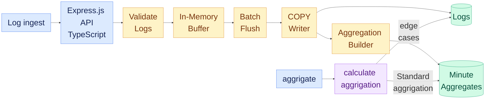

# Log Ingestion and Query Service

A high-throughput structured log ingestion and query service built with TypeScript, Express,

The service provides:

- **Store logs from different services**
- **Handle high-volume log ingestion reliably**
- **Query and filter logs by service, level, time range, and other attributes**
- **Aggregate logs over configurable time intervals**

---
## Architecture Overview

The service uses **in-memory buffering and batched `COPY` writes** to improve ingestion throughput and smooth traffic spikes. Its **dual-path aggregation engine** uses **pre-aggregated** data for **fast queries** and scans raw logs when text or JSON attribute filters are applied, while handling **edge cases** efficiently.

--------

------
# Schema Design

**Attribute Storage Strategy:**  Store attributes as PostgreSQL JSONB key/value pairs to support flexible attributes and dynamic filtering without schema changes.
**Indexing Strategy:** Use a composite B-tree index on (service, level, timestamp DESC, id DESC) to support service and level filtering, timestamp range queries, and cursor-based pagination.
**Primary Key:** Use a composite primary key on (timestamp, id) to ensure row uniqueness and support time-based queries and cursor pagination.

----
 
# Bottlenecks Discovered

-  **High Ingestion Latency(P95 > 1500ms):** The client must wait for disk I/O, transaction commit, and network hops on every single request.

- **Row-Lock Contention:** If 1,000 requests arrive in the same second, they all attempt to UPSERT into log_minute_aggregates for the same minute, causing PostgreSQL transactions to wait on row locks.

- **Dropped Iterations:** Because responses take too long, the benchmark generator backs up and drops iterations.

---
# Benchmark Results

## Optimization Progress
| Optimization stage                        | Correctness | Performance | Queries | Reliability | Total      |
| ----------------------------------------- | ----------- | ----------- | ------- | ----------- | ---------- |
| PostgreSQL Configuration Optimization                      | 12.0/15     | 21.9/50     | 0.0/15  | 20/20       | 53.9% |
| Added index strategy                      | 15.0/15     | 26.9/50     | 6.0/15  | 20/20       | 67.9%  |
| Dual-path aggregation engine              | 15.0/15     | 28.3/50     | 6.0/15  | 20/20       | 69.3% |
| In-memory buffering + batched COPY writes | 15.0/15     | 47.1/50     | 14.9/15 | 20/20       | 97.0% |

## Scenario Results 

| Scenario   | Throughput    | Ingestion p95 | Aggregation p95 | Error rate      |
| ---------- | ------------- | ------------- | --------------- | ----------- |
| Load       | 14,858 logs/s | 119.6 ms      | 6 ms            | 0%   |
| Stress     | 20,928 logs/s | 230.0 ms      | 20 ms           | 0%   |
| Spike      | 15,372 logs/s | 151.7 ms      | 20.1 ms         | 0%   |
| Breakpoint | 21,139 logs/s | 2,590 ms      | 1,186.6 ms      | 0% |

---
# Setup Instructions

**Prerequisites:**
Docker, Git.

The project is designed to run using Docker Compose.

```bash
git clone "https://github.com/showq0/log-ingestion"
cd <your project-directory>
docker compose up --build
```

application container is exposed through `localhost:8080`. 

**Health Check:**  `curl http://localhost:8080/health`

---
# API Documentation

## GET `/health`

Returns the service health status.

**Request:** GET `/health`

**Response:** 200 OK

---

## POST `/logs`

Ingests a batch of logs.

**Request :**  `POST /logsContent-Type: application/json`

**Example:**

```json
{
  "logs": [
    {
      "timestamp": "2026-07-20T14:32:01.123Z",
      "level": "error",
      "service": "checkout",
      "message": "payment declined",
      "attributes": {
        "user_id": "42",
        "region": "eu-west",
        "retries": 3
      }
    }
  ]
}
```

**Each entry must satisfy:**

- `timestamp` must be a valid ISO 8601 timestamp & cannot be more than five minutes in the future
- `level` must be `debug`, `info`, `warn`, or `error`
- `service` must be non-empty
- `message` must be non-empty
- `attributes` must be a flat object
- Nested objects and arrays are not accepted

**Successful Response** `200`

```json
{
  "accepted": 9,
  "rejected": [
    {
      "index": 3,
      "reason": "invalid level: 'critical'"
    }
  ]
}
```

**Failed Response 400** 

```sql
{
  error: "The request body contains malformed JSON",
}
```

---

## GET `/logs`

Filter stored logs based on query parameter.

**query parameter: service** (Exact service-name match), **level**(log-level), **since, until, attr.<key>,q** (substring search on message),**limit, cursor:** pagination cursor

All query parameters are optional and can be combined as this:

```
GET /logs?service=checkout&level=error&since=2026-07-20T14:00:00Z&until=2026-07-20T15:00:00Z&limit=100
```

**Response**

```json
{
  "logs": [
    {
      "id": "123",
      "timestamp": "2026-07-20T14:32:01.123Z",
      "level": "error",
      "service": "checkout",
      "message": "payment declined",
      "attributes": {
        "user_id": "42"
      }
    }
  ],
  "next_cursor": null
}
```

```json
{
  "error": "description"
}
```

---

## GET `/logs/aggregate`

Divides the specified time range into fixed intervals (buckets) such as **1 minute, 5 minutes, 1 hour, or 1 day**, then aggregates the matching logs within each interval and *optionally* groups the results by service or another supported dimension.

### parameter:

**Required:** `since` ,`until` ,`bucket` (`1m` ,`5m` ,`1h` ,`1d`)

**optionally group by:** `group_by` (`group_by=service` ,`group_by=level`)

**optionally **filters by** :`service`  ,`level` ,`attr.<key>` , `q`

Example:

```
GET /logs/aggregate?since=2026-07-20T14:00:00Z&until=2026-07-20T15:00:00Z&bucket=1m&group_by=service
```
Example response:

```json
{
  "buckets": [
    {
      "start": "2026-07-20T14:00:00Z",
      "group": "checkout",
      "count": 118
    },
    {
      "start": "2026-07-20T14:01:00Z",
      "group": "checkout",
      "count": 97
    }
  ]
}
```


## Conclusion

The benchmark results show that database tuning and indexing provided incremental improvements, while the combination of a dual-path aggregation engine, bounded in-memory buffering, and batched PostgreSQL `COPY` writes delivered the largest performance gains. The final configuration achieved 14,858 logs/second, 120 ms ingestion p95 latency, and 6 ms aggregate query p95 latency, with zero reported errors and all reliability scenarios passing.

